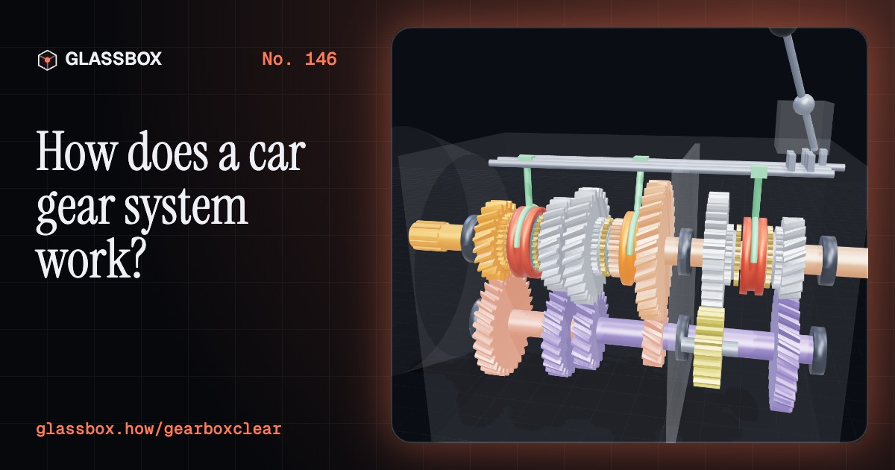
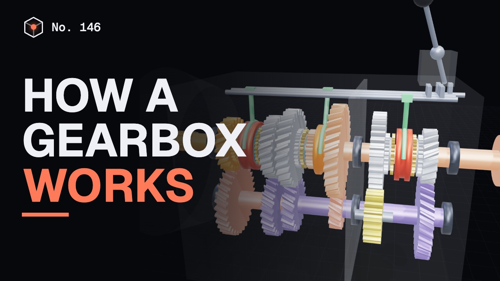
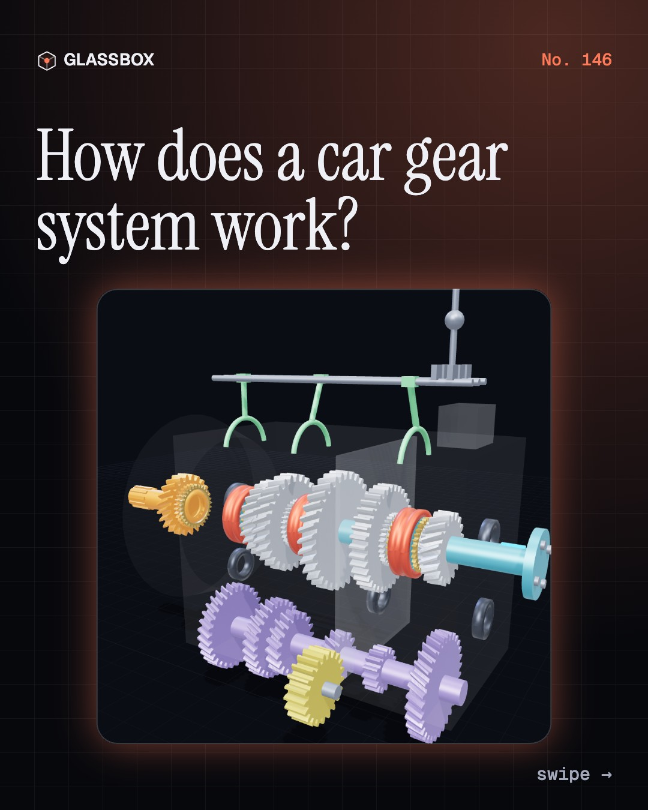
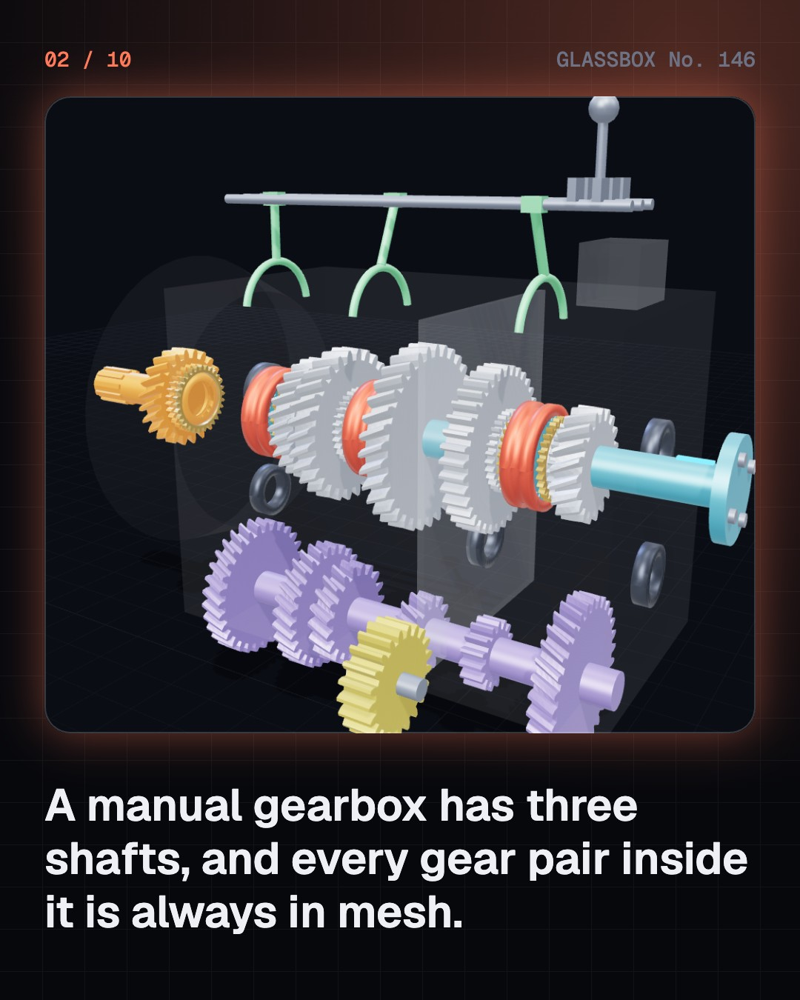
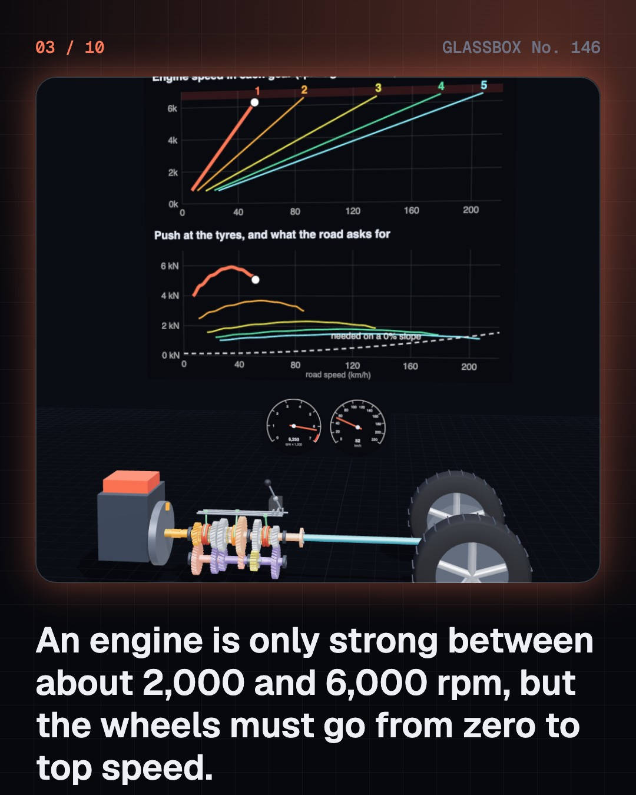
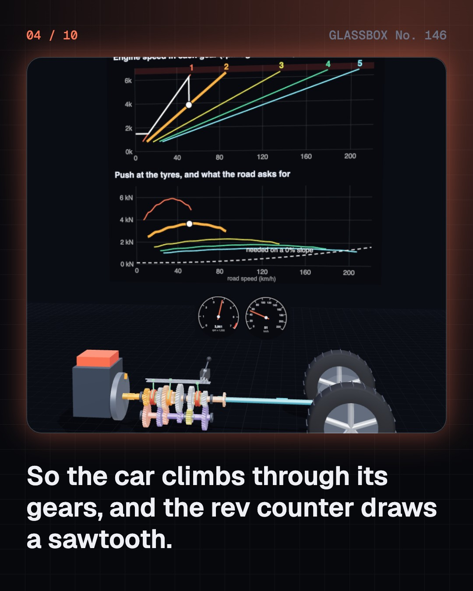

<!-- glassbox:start -->
<!-- Generated from glassbox.json by the Glassbox hub (npm run readme -- gearboxclear). Edit glassbox.json, not this block. -->
<p align="center"><a href="https://glassbox.how/e/gearboxclear/"></a></p>

<h1 align="center">GearboxClear</h1>

<p align="center"><b>How does a car gear system work?</b><br>Three shafts, a row of gears that never unmesh, and a collar that slides to pick one. Open a five-speed gearbox in 3D, follow the power through every gear, and watch synchromesh match the speeds in slow motion.</p>

<p align="center"><a href="https://glassbox.how/gearboxclear/"><b>▶ Play with it</b></a> &nbsp;·&nbsp; <a href="https://glassbox.how/e/gearboxclear/">Read the 60-second explainer</a> &nbsp;·&nbsp; <a href="https://glassbox.how/gearboxclear/glassbox/reel.mp4">Watch the 40-second video</a></p>

<p align="center">
  <a href="https://glassbox.how/e/gearboxclear/"></a>
  <a href="https://glassbox.how/e/gearboxclear/"></a>
  <a href="LICENSE"></a>
  <a href="LICENSE-CONTENT.md"></a>
  <a href="#privacy"></a>
</p>

## In 60 seconds

1. **Three shafts, and gears that never unmesh.** A classic manual gearbox has an input shaft from the clutch, a layshaft below it, and a main shaft out to the wheels. Every gear pair is always in mesh. The gears on the main shaft spin freely until a sliding collar locks one of them to the shaft.
2. **Why an engine needs gears.** A petrol engine only pulls well between about 2,000 and 6,000 rpm, and cannot run near zero. The wheels need a big shove to start and a small one to cruise. Wheel torque is engine torque times the gear ratio times the final drive, so low gears multiply twist and high gears give speed.
3. **Follow the power.** In first, the power goes down to the layshaft and back up through a 14-tooth gear driving 33: with the 22 to 31 input pair that makes 3.32 to 1. Fourth is direct, the two shafts locked as one. Fifth is an overdrive at 0.86. Reverse adds an idler gear that flips the direction.
4. **Synchromesh matches the speeds.** The collar turns with the wheels and the gear with the engine side, so their teeth would clash. A brass baulk ring rubs on a cone on the gear, drags it to the shaft's speed in about a tenth of a second, and blocks the collar until the two match.
5. **The differential shares the drive.** In the axle a 10-tooth pinion turns a 39-tooth crown wheel: the final drive. Inside the crown, spider gears let the outer wheel turn faster than the inner one in a corner. Their weakness: both wheels always get the same torque, so one wheel on mud can strand the car.
6. **Four kinds of automatic.** A torque converter passes power through oil and uses planetary gear sets. A CVT runs a steel belt on two pairs of cones for stepless ratios. A dual-clutch gearbox keeps the next gear waiting on a second shaft. An AMT is a manual gearbox worked by actuators, which is why it pauses.

## Words worth knowing

| Term | Meaning |
|---|---|
| **Gear ratio** | Turns of the input for one turn of the output, found from tooth counts: driven teeth divided by driving teeth, multiplied along the path. |
| **Layshaft** | The countershaft: one solid cluster of gears that turns whenever the gearbox input turns. |
| **Constant mesh** | A gearbox whose gear pairs stay meshed. You change gear by locking a different gear to its shaft with a sliding collar. |
| **Direct drive and overdrive** | Direct drive locks input to output at 1 to 1. An overdrive gear has a ratio below 1, so the output turns faster than the engine. |
| **Synchromesh** | A small cone clutch with a brass baulk ring that matches a gear's speed to the shaft before the collar engages. |
| **Final drive** | The last gear pair, in the axle. Its ratio multiplies every gear's ratio, here 39 divided by 10, or 3.9. |
| **Differential** | Gears that split the drive between two wheels while letting them turn at different speeds in a corner. |
| **Torque converter** | An oil-filled coupling with a pump, a turbine and a stator. It replaces the clutch in a classic automatic and multiplies torque when pulling away. |
| **Planetary gear set** | A sun gear, planet gears on a carrier and a ring gear. Holding one member and driving another gives different ratios without unmeshing anything. |

## A short history

**2,100 years from bronze gearwheels in a Greek shipwreck to gearboxes that shift themselves, and electric cars that need only one gear.**

- **100 BCE** · Bronze gears under the sea (Unknown Greek craftsmen, Found off Antikythera, Greece)
- **1827** · A clockmaker's differential (Onésiphore Pecqueur, Paris, France)
- **1891** · “Brutal, but it works” (Émile Levassor and René Panhard, Paris, France)
- **1898** · A top gear that drives straight through (Louis Renault, Rue Lepic, Montmartre, Paris, France)
- **1928** · Synchromesh ends the crunch (Earl A. Thompson and Cadillac, Detroit, Michigan, USA)
- **1939** · The Hydra-Matic: no clutch pedal at all (Earl A. Thompson and General Motors, Detroit, Michigan, USA)
- **1958** · A car with no gears to change (Hub van Doorne and DAF, Amsterdam and Eindhoven, Netherlands)
- **2003** · The dual-clutch gearbox goes on sale (Volkswagen and BorgWarner, Wolfsburg, Germany)

The full story, with 30 moments, charts, people and 60 sources: [glassbox.how/e/gearboxclear/history](https://glassbox.how/e/gearboxclear/history/). The data lives in [`history.json`](history.json).

## Video and slides

Made with the Glassbox studio from this box's storyboard (`window.glassbox.director`). Free to reuse under CC BY 4.0.

<a href="https://glassbox.how/gearboxclear/glassbox/video.mp4"></a>

<p><a href="glassbox/slide-1.jpg"></a> <a href="glassbox/slide-2.jpg"></a> <a href="glassbox/slide-3.jpg"></a> <a href="glassbox/slide-4.jpg"></a></p>

| File | What | Size |
|---|---|---|
| [`glassbox/reel.mp4`](https://glassbox.how/gearboxclear/glassbox/reel.mp4) | Reel / Short, with captions and soundtrack | 1080×1920 |
| [`glassbox/video.mp4`](https://glassbox.how/gearboxclear/glassbox/video.mp4) | YouTube video, with captions and soundtrack | 1920×1080 |
| `glassbox/slide-1…10.jpg` | Instagram carousel | 1080×1350 |
| `glassbox/thumb.jpg` | YouTube thumbnail | 1280×720 |
| `glassbox/cover.jpg` | Share card and repo social preview | 1200×630 |
| [`glassbox/history-reel.mp4`](https://glassbox.how/gearboxclear/glassbox/history-reel.mp4) | “History in 10 moments” Reel / Short | 1080×1920 |
| `glassbox/history-slide-*.jpg` | History carousel | 1080×1350 |
| `glassbox/post.json` | Post copy and schedule used by the publish kit | |

## Privacy

This box has no accounts and no ads, and it ships its own fonts and libraries. When you run it yourself it sends nothing anywhere. On glassbox.how, the site's `/bar.js` also loads Glassbox's analytics: **Google Analytics** to count visits (it asks first in the EU, UK and Switzerland, and stays off when your browser sends Global Privacy Control or Do Not Track) and **ClickTrust** to detect bots.

It remembers a few things **in your own browser only**, and never sends them anywhere:

| Browser storage key | What it holds |
|---|---|
| `gearboxclear.v1` | Which chapters you have opened, your best quiz scores, and sound on or off. |

Exactly what each one sees is at [glassbox.how/privacy](https://glassbox.how/privacy/).

## Licences

- **Code:** [MIT](LICENSE). Use it, change it, ship it.
- **Explanations, text, images and videos** (`glassbox.json`, `glassbox/`): [CC BY 4.0](LICENSE-CONTENT.md). Credit “Glassbox, glassbox.how/e/gearboxclear”.
- **Third-party parts** keep their own licences: [three.js](https://threejs.org) (MIT), [Geist, Instrument Serif](https://openfontlicense.org) (SIL OFL 1.1).
- The Glassbox name and logo aren't covered by either licence. See the [terms](https://glassbox.how/terms/).

Found a mistake? [Open an issue](https://github.com/bdeeps/gearboxclear/issues). Corrections happen in public.
<!-- glassbox:end -->

## Run it

It's plain HTML, CSS and JavaScript. No build step and no dependencies. Run locally, it contacts no other website.

```bash
python3 -m http.server 8000
```

Three.js and the fonts ship in `vendor/` and `fonts/`, so it also works offline.

Then open http://localhost:8000.

## How it's built

| File | What |
|---|---|
| `index.html`, `css/app.css` | The page and its styles |
| `js/app.js`, `js/stage.js`, `js/ui.js`, `js/kit.js` | The shared Glassbox 3D engine: chapters, 3D stage, controls, quiz, video director |
| `js/gearbox.js` | Shared models and numbers: meshing spur, helical, internal and bevel gears, the three-shaft five-speed gearbox with its tooth counts, the final drive, the engine and car figures, chart helpers |
| `js/chapters/*.js` | One file per chapter: the 3D model, controls, text, key terms, quiz and video scenes |
| `glassbox.json` | Title, question, explainer beats, key terms, browser storage and credits shown on glassbox.how |
| `reel` in each chapter | The storyboard the Glassbox studio records into short videos |
| `glassbox/` | The published video, slides, thumbnail and post copy |
| `fonts/`, `vendor/three/` | Self-hosted Geist and Instrument Serif (SIL OFL 1.1) and three.js (MIT) |
